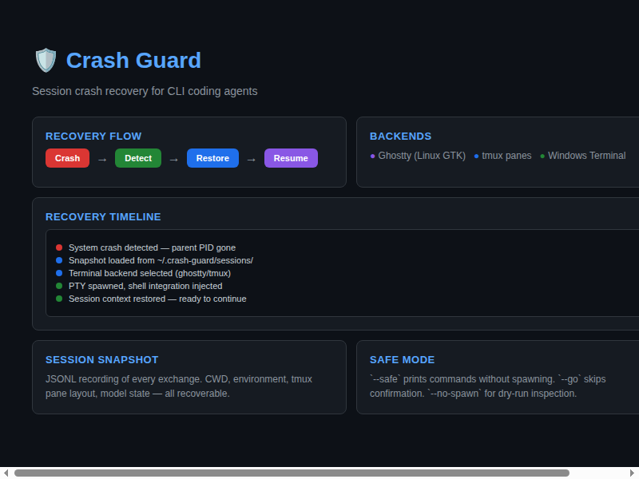

# crash-guard



[](https://github.com/aaaronmiller/crash-guard)
[](MIT)
[](https://python.org)

> Reopens your agent CLI sessions after the machine crashes or their terminal window closes.

```
  _____ _____ _____ _____     _____ _____ _____ _____ 
 |  _  |  _  |  _  |  _  |   |  _  |  _  |  _  |  _  |
 | |_| | |_| | |_| | |_| |   | |_| | |_| | |_| | |_| |
 |_____|_____|_____|_____|   |_____|_____|_____|_____|
|_____|_____|_____|_____|   |_____|_____|_____|_____|
```

You had Claude Code, Codex and a few other agents open in terminal tabs. Then
WSL died, or a window closed under them. Run `cgr`. It lists the sessions
that were cut off and reopens the ones you pick, each in a new tab, in its own
directory, with the command line you originally typed plus that harness's
resume flag. Sessions you exited yourself are not listed.

Two more jobs use the same machinery:

- **Before a planned restart**, `cgr --save` records every agent running now.
  Shut down however you like; afterwards `cgr` reopens that same set.
- **For an audit**, `cgr --history` puts every session from every harness on
  the machine into one SQLite database, and flags the ones that were cut off
  or left mid-task.

It needs no launcher prefix, no shell hook and no harness plugin. A small
background watcher reads `/proc`, and `cgr` reads the records each harness
already keeps.

The full theory of operation is in `docs/design.md`: why each mechanism was
chosen over the alternatives, how it meets each goal, the known limits, and
how to re-verify every claim.

## After a crash or a closed window: `cgr`

```bash
cgr               # pick with the arrow keys, reopen each in a new tab
cgr --list        # print what died and the exact command each would run; open no tabs
cgr --yes         # reopen all of them without asking
cgr --all         # earlier events too; groups older than seven days are collapsed
cgr --all --expand-old --list  # show every session and command in older groups
cgr --forget      # stop listing the sessions shown now
cgr --json        # machine-readable list
cgr --save        # before a planned restart: record what runs now
cgr --history     # browse every unfinished session grouped by date; space opens, space picks
```

Example, after the 2026-10-09 WSL crash that this tool was rebuilt for. The
last column shows the start of each conversation's first prompt; the two real
prompts are replaced here:

```
These agent sessions were cut off:

  claude    ~                           10-09 20:26  machine went down  (first words of the claude prompt)
      cd /home/cheta && claude --resume 9a3daff8-0922-4583-a967-02a88760db6e
  codex     ~/code/pareto               10-09 20:15  machine went down  (first words of the codex prompt)
      cd /home/cheta/code/pareto && codex resume 01a12388-3c73-7653-94b6-250a36969bba
```

In the picker recent sessions start ticked: up/down to move, space to toggle,
`a` for all or none, Enter to reopen, `q` to quit. Each chosen session opens
in a new tab of the terminal you ran `cgr` from: a tmux window if you are in
tmux, otherwise a WezTerm tab, otherwise a Windows Terminal tab, otherwise a
tmux session called `cgr`. If a tab cannot be opened, `cgr` prints the command
to run by hand.

The first interactive shell of each boot prints one colored line per group
(`cgr --brief`, from the shell integration).

Recovery is grouped by boot shutdown or crash, with a separate group for
windows closed during each boot. The header gives the boot start, end and
end evidence. Missing shutdown records use the next boot's start and say
that the end is inferred. Native records without a boot id are associated
by their last activity; JSON exposes `group`, `event` and `event_association`.
Activity predating available boot records is grouped by date.

In the picker, Space on a header selects the whole group; Space on a session
selects that session. Press `o` to expand or collapse the current group.
Groups older than seven days start collapsed and unselected. `--expand-old`
shows their sessions; `a` explicitly selects or clears all groups. `--json`
always includes every collected item, even when text output is collapsed.

## Before a planned restart: `cgr --save`

```bash
cgr --save        # records each running agent with its session id
# ...exit them, close the windows, wsl --shutdown, reboot: any of these...
cgr               # after the restart: the saved sessions are listed; Enter reopens them
```

Each saved session is listed once its process is gone, however it ended, and
leaves the list once it is reopened or forgotten. Saving again replaces the
previous set. `--save` prints what it recorded and the exact command each one
will reopen with, so you can check the ids before you shut down. Claude
sessions are saved by their pid file, any session named on its command line
(`codex resume <id>`) by that id, and codex, omp and hermes otherwise by the
newest session in their directory.

## Every session, in one database: `cgr --history`

```bash
cgr --history          # grouped by date with counts; space opens a date, space picks, enter reopens
cgr --history --list   # print the same groups and sessions; open no tabs
cgr --history --all    # every date, not just the newest dates holding 40 sessions
cgr --history --list --group 2 --preview   # one date by its number, with id/msgs/model/last prompt
cgr --history --list --day 2026-10-09      # one date by name (also expands an old date)
cgr --history --day 2026-10-09 --yes       # reopen every session of that date, no terminal needed
sqlite3 -box ~/.local/state/crash-guard/sessions.db 'SELECT * FROM audit'
```

One line per date with its session count, colored like the picker by the
date's dominant kind (green saved, yellow window, red crash; a tie takes the
worse). A mixed date also spells out its counts, e.g. `7 sessions: 4 saved, 1
window, 2 crash`. Space on a date expands it into its sessions, each with its
reopen command (and a preview line with `--preview`); space on a session
ticks it, `a` ticks the whole date, Enter reopens the ticked set in new tabs.

Without `--all` the list stops at the newest dates holding 40 sessions; a date
is never cut in two, and the header says `showing 45 of 50`. Dates older than
seven days print collapsed in `--list` (`--expand-old`, `--day` or `--group`
shows them). `--group N` numbers the dates as printed; `--day` and `--group`
also give a non-terminal way to reopen with `--yes`. Sessions with no id
(`@` rows) are counted but not listed, since "continue the newest" might
reopen another session. A session saved with `--save` keeps `saved` in the
history after the restart, unless its harness wrote a deliberate exit record.

It has store readers for 12 harnesses (claude, codex, omp, pi, hermes, jcode,
 muse, gemini, qwen, opencode/kilo, openclaw) and keeps one row per session:
 id, folder, harness, start and last activity, size, model, git branch, first
 and last prompt, how it ended, and the line that reopens it. First run on this
 machine: 1,455 sessions, 383 to audit.

Each session gets one **status**, with its evidence in the `how` column:

| status | meaning |
|---|---|
| `running` | a process holds it now |
| `closed` | the harness recorded an exit it chose (`/exit`, quit, `status Closed`) |
| `cut off` | it ended without choosing to: machine went down, window closed, killed, a crash status, or no end record where the harness always writes one |
| `unknown` | the harness keeps no end record and nothing else saw it end (pi, gemini, qwen, opencode) |

`mid_turn` = 1 means the record stops on your prompt, a tool call, a tool
result or an error: the agent was still working. The `audit` view lists
sessions you ran yourself (not SDK, `exec`, subagent or scheduled runs) that
are cut off, or unknown and mid-turn, newest first, with the last prompt you
gave each one.

Rows are never deleted. When a harness prunes an old session (Claude Code's
default is 30 days; `cleanupPeriodDays` is 99999 on this machine), its row stays with `in_store` = 0. The watcher refreshes the database
once a day. How each harness's store and end record are read, and why, is in
`docs/design.md` section 17.

## How it works

`cgr` has to answer two questions: which sessions were cut off, and how to
bring each one back as it was.

**Which sessions were cut off.** Two independent sources; either one is
enough.

1. **The watcher** (`cgr --watch`, run by the systemd user service
   `cgr-watch`). Every 2 seconds it lists `/proc` and looks at processes it
   has not seen before. For each agent running on a terminal it records the
   directory, the arguments, and the command line you typed. When an agent
   goes away it asks one question: did the shell that owned its terminal go
   too?
   - If the shell is still at its prompt, you exited, and nothing is recorded.
   - If the shell is dead, the window closed, and the session is recorded.

   It also keeps the list of agents running right now, one file per boot. After
   a crash, the previous boot's list is exactly what was running when the
   machine died. The rule is the same for every harness, because it relies on
   how the kernel hangs up a terminal, not on anything the harness does.
2. **Each harness's own records**, which cover crashes the watcher was not
   running for:

   | harness | what marks a session cut off |
   |---|---|
   | claude | `~/.claude/sessions/<pid>.json` left behind (Claude deletes it on every exit it gets to run, SIGHUP included); a closed window also leaves `SessionEnd` reason `other` |
   | codex | no `Agent loop exited` for the thread in `~/.codex/logs_*.sqlite` (codex logs one on `/quit` and after a closed window, but not when the machine dies) |
   | omp | no `session_exit` record at the end of the transcript, or one naming `sighup` (window closed) or `sigterm` (killed) |
   | hermes | `ended_at` still NULL in `~/.hermes/state.db` |

By default `cgr` only looks back to the start of the previous boot (read from
`/var/log/wtmp`), so weeks-old sessions never show up. A boot the watcher saw
end with no agent running is stepped over, so WSL booting itself again after
a crash (its updater does) does not hide the boot your agents died in. Headless runs
(`claude -p`, SDK runs, `codex exec`, subagents) are never listed. A session
whose id is on the command line of an agent running now (you already resumed
it) is not listed either.

**How to bring each one back.** `cgr` reruns what you typed, minus old session
flags and prompts, plus the harness's resume flag:

| you typed | reopens as |
|---|---|
| `claude` | `claude --resume <id>` |
| `cc` (an alias for a proxied claude) | `cc --resume <id>` |
| `codex -m gpt-6-sol` | `codex -m gpt-6-sol resume <id>` |
| `oc-direct` (an opencode alias) | `oc-direct --continue` |

The typed line comes from `~/.zsh_history`, matched by timestamp to the
process start. The watcher reads it within 2 seconds of the launch, because
zsh's `HIST_IGNORE_ALL_DUPS` deletes an older entry as soon as the same command
is typed again. Each reopened tab runs
`$SHELL -lic "cd DIR && { export CGR_LAUNCH=<typed>; <command>; }; exec $SHELL -l"`:
your aliases and proxy functions are loaded, a shell stays open afterwards,
and `CGR_LAUNCH` carries the original line forward so a session reopened twice
does not drift. If no typed line exists, the rebuilt command is exported
instead, so the next launch cannot borrow an unrelated history entry. Initial
`-i` or `--prompt-interactive` prompts are removed rather than replayed.

### Why this design

`docs/design.md` (section 10) records each alternative with its evidence. In
short:

- **A launcher wrapper (`cg_run`)** only sees launches that go through it.
  That was 12% of aliases and none of the daily ones, which is why the old
  `cgr` found nothing on 2026-10-09.
- **Guessing from file times** misses idle sessions: an open but idle agent
  writes nothing. It also listed six unrelated sessions on 2026-10-09.
- **A hook on every shell command** was built and removed the same evening.
  It ran on every command in every shell.
- **Hooks inside each harness** exist for only some harnesses, and none of
  them fires when the machine dies.
- **Event-driven process tracing** either needs root (eBPF, auditd) or, inside
  WSL2, reports process ids from another namespace (the netlink process
  connector, measured).
- **Polling `/proc`** needs no privileges and no config change, sees every
  harness, and costs about 0.1% CPU and 18 MB.

## Supported harnesses

The watcher recognizes 15 harness names. On 2026-10-13, 13 are installed;
ante and omx are absent, so their CLI definitions have not been rechecked.
The watcher also recognizes the installed pi and qwen npm entrypoints whose
filenames are `cli.js` and `cli-entry.js`. It rejects one-shot Qwen positional
queries unless interactive mode was requested.
The history index has native readers for 12 names, including kilo, which
currently has no local store. Agy is indexed from watcher evidence after its
presence lock has been matched to a conversation.

| harness | recovery evidence | resume command |
|---|---|---|
| claude | watcher and native records | `--resume <id>` |
| codex | watcher and native machine-death records | `resume <id>` |
| omp | watcher and native exit records | `--resume <id>` |
| hermes | watcher and native open-session records | `--resume <id>` |
| agy | watcher, with a unique presence-lock match | `--conversation <id>` |
| jcode | watcher and indexed crash status | `--resume <id>` |
| muse | watcher and indexed exit evidence | `resume <id>` |
| openclaw | watcher and indexed failed-session windows | `resume <id>`; the CLI matches the session id among recent sessions |
| pi, opencode, kilo, gemini, qwen | watcher; native stores resolve ids | CLI-specific resume-by-id flags |
| ante, omx | watcher if installed; no native store reader | original continue flags |

A missing working directory leaves a selected session unhandled and prints
the problem, so opening an empty tab cannot count as recovery.

Recovery reads `sessions.db` for additional harnesses using interactive,
cut-off rows still in their stores. Missing or day-old indexes refresh before
recovery; fresh indexes are reused. The refresh derives verdicts from native
stores and watcher evidence, so it cannot keep a stale verdict alive by
reading it back as new evidence. Recent missing end markers alone do not
prove a current-boot death.

Zero cut-off rows for pi, gemini, qwen and opencode do not mean clean exits.
Their current records have no process-exit signal. All 373 rows in those four
stores are `unknown` on 2026-10-13; 100 stop mid-turn and remain candidates
for `--history` audit. A watcher death can still make them recoverable.

## Install

```bash
git clone https://github.com/aaaronmiller/crash-guard ~/code/crash-guard
cd ~/code/crash-guard
bash scripts/install.sh
```

`scripts/install.sh` never edits your shell rc files. It:

- copies `bin/crash-guard` to `~/.local/bin/` and symlinks `cgr` and the other
  `cg-*` tools there, so code updates in the repo go live;
- copies `shell/crash-guard.sh` to `~/.config/crash-guard/`;
- installs `systemd/cgr-watch.service` to `~/.config/systemd/user/`, then
  enables and starts it (it warns and skips this where there is no systemd
  user instance; run `cgr --watch` yourself there).

**Recommended for Claude Code:** add the `SessionEnd` hook, which lets `cgr`
tell a closed Claude window from `/exit` even when the watcher is down. In
`~/.claude/settings.json`:

```json
"hooks": {
  "SessionEnd": [
    { "hooks": [ { "type": "command",
                   "command": "/path/to/crash-guard/bin/cg-session-end" } ] }
  ]
}
```

It fires once, when a session ends, and appends one record with the reason
(`other` for a closed window, `prompt_input_exit` for `/exit`). Every failure
path exits 0, so it can never block a shutdown.

**Optional shell integration.** It adds the once-per-boot "sessions died"
line, `cg_run`, and the aliases `cgs`, `cgh` and `cgr-batch` (= `cgr --yes`).
It adds no per-command hook. Add it to `~/.zshrc` or `~/.bashrc`, with the
PATH line first:

```bash
export PATH="$HOME/.local/bin:$PATH"
source "$HOME/.config/crash-guard/crash-guard.sh"
```

`cgr` is a program on PATH, not an alias. If your rc file still has the old
`alias cgr='crash-guard restore'`, delete it: an alias shadows the program.

## Operating the watcher

```bash
systemctl --user status cgr-watch            # running? (cgr also warns when it is not)
journalctl --user -u cgr-watch -n 20         # recent errors, if any
systemctl --user restart cgr-watch           # after updating bin/cgr
systemctl --user disable --now cgr-watch     # turn it off
systemctl --user enable --now cgr-watch      # turn it back on
```

Without the watcher, `cgr` still finds every cut-off Claude session, and
codex, omp and hermes sessions lost to a machine death. It misses every other
closed window, codex's included: codex logs the same teardown for a closed
window as for `/quit`.

Enabled is not running. With `Restart=always`, a watcher that fails at
startup is restarted every 5 seconds and the unit still looks alive. From
2026-10-23 to 2026-10-29 it restarted 63,113 times on a death record torn by
a WSL crash, and two closed codex windows were never recorded. On this
machine the guardian cron job checks it daily at 04:00 and fails, with a
notification, when the watcher is down or has restarted since the last check.

## Files

All under `~/.local/state/crash-guard/`:

| file | what it holds |
|---|---|
| `watch/live-<boot_id>.json` | agents running now, one file per boot |
| `watch/deaths.jsonl` | agents whose window closed under them |
| `watch/watch.pid` | the watcher's pid and boot id |
| `watch/boot-<boot_id>` | when this boot started, read once early on, before the clock drifts |
| `cgr-handled.json` | sessions already reopened or forgotten, hidden until they die again |
| `saved.json` | what `cgr --save` recorded, with session ids |
| `sessions.db` | `cgr --history`: every session from every harness (SQLite) |

Records older than 30 days are pruned when the watcher starts. Each death is
flushed to disk as it is written; a line torn by a crash mid-write (WSL
leaves it as NUL bytes) is skipped when read and dropped at the next start.
Field-level
formats are in `docs/design.md`, section 14.

**Privacy.** These files hold each agent's working directory, arguments and
typed command line, in plain text, and `sessions.db` holds each session's
first and last prompt. Do not pass secrets as command-line
arguments. The directories are owner-only (`0700`) and the files `0600`, the
same rule the ledger's `history.jsonl` follows. Older files with looser modes
are repaired when the watcher starts.

**Other accounts.** The watcher records only your own processes, and `cgr`
reads only state files you own. Titles and commands are printed with control
characters shown as `?`, so a prompt or a model-written thread name cannot
send escape sequences to your terminal.

## Troubleshooting `cgr`

| symptom | cause and fix |
|---|---|
| `cgr: the watcher is not running` | check it: `systemctl --user status cgr-watch`. Not enabled: `systemctl --user enable --now cgr-watch`. Enabled but restarting over and over: `journalctl --user -u cgr-watch -n 20` shows the error |
| a session you exited is listed | you exited and closed the window within about 2 seconds, or closed the window on purpose. Untick it, or run `cgr --forget` once it is the only one listed |
| a session you already resumed by hand is listed | it was resumed without its id on the command line (for example `claude --continue`) and the harness has not written its own record yet. Wait a few seconds, or use the exact command from `cgr --list` |
| a reopened tab runs the wrong command | check the `typed` and `command` fields in `cgr --json`. History is zsh-only; other shells fall back to the process arguments |
| nothing reopens, commands are printed instead | no tmux, WezTerm or Windows Terminal CLI was usable; run the printed commands |
| `cgr` is the old restore picker (crash-guard banner) | an `alias cgr=...` shadows the program: remove it from your rc file. A tab opened before you removed it keeps the alias in memory: open a new tab, or run `unalias cgr` there |

`docs/design.md` section 11 lists every known limit with its cause.

## Repository layout

```text
bin/cgr                cgr: find cut-off sessions and reopen them; --save, --history; --watch is the watcher
systemd/cgr-watch.service  the watcher as a systemd user service
bin/cg-session-end     Claude Code SessionEnd hook: records how a session ended
docs/design.md         theory of operation, alternatives, limits, audit procedure
tests/                 unittest/pytest suite (tests/test_cgr.py covers cgr)
bin/crash-guard        the older cg_run ledger: restore, history, metrics, ledger bridge
bin/cg-recover         marker-based detection behind `crash-guard recover` (superseded by cgr)
bin/cg-forensic        inferential detection (superseded by cgr)
bin/cg-snapshot        periodic process snapshots (superseded by the cgr watcher)
bin/cg-correlate       reconciles shell history, session logs and snapshots
bin/cg-telemetry       collects crash telemetry and renders an HTML report
bin/cg-harness-monitor samples memory use per harness over time
shell/crash-guard.sh   shell integration: cg_run, cgs, cgh, cgr-batch, login notice
scripts/install.sh     installs files and the watcher; does not edit shell rc files
scripts/install-cron.sh  installs crash-guard's scheduled jobs
ANALYTICS.md           metrics and dashboards for the cg_run ledger
grafana/               Grafana dashboard for those metrics
CHANGELOG.md           project changes
LICENSE                MIT license
```

The repository has no build step and no third-party Python dependencies.
Tests: `python3 -m pytest tests -q`.

---

## Legacy: the `cg_run` ledger and `crash-guard restore`

Everything below describes the older recovery path. It still works, but it
only sees sessions launched through the `cg_run` wrapper, which is why it is
no longer the answer to "what died". `cgr` does not depend on it. Its
history, metrics and the Living Documents ledger bridge remain available.

Crash-guard keeps a durable recovery ledger for agentic CLI / TUI sessions
launched through `cg_run`, and restores them after WSL restarts, terminal
crashes, or failed restore attempts. It is not a PTY recorder. It stores
enough metadata to relaunch the right continue/resume command in the right
working directory, through the same captured non-secret proxy-routing
environment.

### What it covers

**Sentinels** (`cg_run`, the ledger) work for anything launched through the
wrapper: `claude`, `codex`, `opencode`, `hermes`, `pi`, `kilo`, `ante`, `rtk`,
and wrapper-launched commands such as `rtk`/`xx`. Anything started outside
`cg_run` is invisible to this half, however it was installed. Note that the
`cg_run` SIGHUP trap records a closed window as a clean stop, so a wrapped
session lost to a closed window is not offered here; `cgr` handles that case.

**Detection** (`crash-guard recover`) reads harness session stores directly
and needs no wrapper, but only where a scanner exists:

| harness | how it is decided |
|---|---|
| omp | definitive -- `session_exit` record |
| hermes | definitive -- `ended_at` / `end_reason` in `state.db` |
| claude code | definitive once `cg-session-end` is installed; heuristic before that |
| codex | heuristic -- unfinished turn + write in the pre-boot gap |
| pi (legacy `~/.pi`) | heuristic -- predates the `session_exit` marker |
| qwen | heuristic -- writes claude's schema, so the same scanner reads it |

Not scanned: `gemini`, `opencode`, `kilo`, `jcode`, `agy`.

### How ledger recovery works

Recovery needs two different facts, and no single source has both.

**Which sessions were open: markers.** omp ends a clean session with a final
`{"type":"custom","customType":"session_exit"}` record, and hermes sets
`ended_at` + `end_reason` in `~/.hermes/state.db`. Claude Code gains the same
tell once `bin/cg-session-end` is installed as a `SessionEnd` hook. Codex and
legacy `~/.pi` write no terminal record that this path reads, so it falls back
to requiring two signals: a last write inside the pre-boot gap *and* an
unfinished final turn (a `tool_use` with no `tool_result`, or a user turn with
no reply).

**How to bring one back: sentinels.** `cg_run` records the argv a session was
launched with, including any wrapper (`rtk hermes`), and the proxy-routing
environment the alias injected (`OPENAI_BASE_URL=...`). Resuming without it
can reconnect to a different backend than the session was using. (`cgr` gets
the same information from the typed command line instead, because the alias
re-runs inside an interactive shell.)

```bash
crash-guard recover              # every open session, from the markers
crash-guard recover --restore    # reopen chosen ones in tmux, in their own dirs
crash-guard recover --compare    # cross-check against the inferential detector
```

`crash-guard restore` drives the sentinel ledger directly. When that ledger is
empty it falls back to the markers rather than reporting nothing.

### Ledger setup

The shell integration (see Install above) defines `cg_run` and the ledger
aliases `cgs` (`crash-guard status`), `cgh` (`crash-guard history`) and
`cgr-archive` (`crash-guard restore --from-archive --terminal ghostty`). Wrap
launcher aliases with `cg_run`, after the `source` line. Tracked launcher
aliases on a machine that uses the `xx` proxy:

```bash
alias cc='cg_run xx cip'           # Claude init, proxy
alias ccc='cg_run xx ccf'          # Claude continue, proxy, free tier
alias hsi='cg_run xx hip'          # Hermes init, proxy
alias hsr='cg_run xx hcf'          # Hermes continue, proxy, free tier
alias psi='cg_run xx pip'          # Pi init, proxy
alias psi-c='cg_run xx pcf'        # Pi continue, proxy, free tier
alias qw='cg_run xx qip'           # Qwen init, proxy
alias qw-c='cg_run xx qcf'         # Qwen continue, proxy, free tier
alias codex-run='cg_run xx xip'    # Codex init, proxy
alias codex-res='cg_run xx xcf'    # Codex continue, proxy, free tier
alias oc='cg_run xx oip'           # OpenCode init, proxy
alias ante='cg_run xx aip'         # Ante init, proxy
```

Without `xx`, wrap the real command directly:

```bash
alias cc='cg_run claude -- rtk claude --dangerously-skip-permissions'
alias ccc='cg_run claude -- rtk claude --continue --dangerously-skip-permissions'
alias codex-run='cg_run codex -- rtk codex --dangerously-bypass-approvals-and-sandbox'
alias codex-res='cg_run codex -- rtk codex resume'
alias oc='cg_run opencode -- rtk opencode'
alias hsi='cg_run hermes -- rtk hermes'
alias hsr='cg_run hermes -- rtk hermes --resume'
```

Session naming: `alias my-pi='cg_run --name "pi-on-crash-guard" rtk -- pi -c'`
shows the name in restore groups.

Terminal notes for the ledger's restore:

- Ghostty on Linux/Fedora: install `tmux`; crash-guard uses tmux windows as
  tab-equivalents because Ghostty exposes `new_tab` as a keybind, not a
  `+new-tab` CLI action.
- WezTerm: install `wezterm` or `wezterm.exe`; existing-window tab spawning is
  preserved.
- Kitty: enable remote control if you want native Kitty tabs; crash-guard
  falls back to a new Kitty OS window if remote launch fails.
- Windows Terminal from WSL: `wt.exe` and `wsl.exe` must be on PATH.

### Staying updated

```bash
crash-guard self-update                            # auto-detect repo
crash-guard self-update --repo ~/code/crash-guard  # explicit path
```

The installer writes a repo marker file; after that `crash-guard self-update`
handles stash, pull, reinstall, and version verification. Restart the watcher
afterwards: `systemctl --user restart cgr-watch`.

### Ledger commands

```bash
crash-guard       # ledger restore picker; Enter restores all visible sessions
cgs               # current live/stale/crashed sentinel status
cgh               # OS boot-period history browser
cgr-archive       # retry records already moved to archive
```

The ledger picker shows recovery groups, then lets you use arrow keys or
numbers to restore all visible sessions, select a group, or select one
individual session inside a group. Restore groups show session duration,
git branch and dirty state, and any `cg_run --name` label. Sessions that ran
under 5 seconds are never shown.

```bash
crash-guard --dry-run
crash-guard restore --yes
crash-guard restore --group 2
crash-guard restore --group 2 --item 3
crash-guard restore --boot <boot-id> --group 1
crash-guard restore --from-archive --list-groups
crash-guard restore --from-archive --group 1
crash-guard restore --from-archive --group 1 --item 2
crash-guard restore --from-archive --terminal ghostty
crash-guard restore --no-spawn
crash-guard restore --include-closed   # also show cleanly closed sessions
crash-guard restore --include-closed --list-groups  # preview only
```

### History

Crash-guard keeps append-only history at
`~/.local/share/crash-guard/history.jsonl`. It also folds in live and archived
sentinels, so a failed restore does not erase the only recovery record. When
you restore a visible group, crash-guard saves that group membership before
archiving old sentinels; `crash-guard restore --from-archive` lets you select
the saved group again.

`crash-guard history` lists OS boot periods with record counts, then that
period's recovery groups. Clean exits are kept as individual closed-session
records; crashed, stale, or archived sessions that ended together are grouped;
the newest recoverable group is group `1`; older boot periods are restored
with `--boot <boot-id>`.

Cleanup is explicit and dry-run by default:

```bash
crash-guard excise --older-than 365
crash-guard excise --older-than 365 --apply
```

`--apply` requires typing `Jettison the ghosts` before old history is removed.

### Terminal backends

| backend | behavior |
|---------|----------|
| `tmux` | new tmux windows, meaning full-screen tab-like workspaces, not panes |
| `ghostty` | resolves to tmux on Linux for tab-like restore behavior |
| `wezterm` | new tabs in the current/sole WezTerm window when resolvable |
| `kitty` | new tabs through Kitty remote control, with OS-window fallback |
| `windows-terminal` | new Windows Terminal tabs through `wt.exe` + `wsl.exe` |

Force one with `crash-guard restore --terminal tmux|ghostty|wezterm`.

### Config

Default config: `~/.config/crash-guard/programs.json`. It controls terminal
backend selection, per-tool continue/resume commands, session-store locations,
captured environment patterns, the restore pre-hook, and restore spawn delay.
`cgr` does not read it.

- `terminal.backend` -- `auto` (default), `tmux`, `wezterm`, `kitty`, `ghostty`, `windows-terminal`
- `terminal.order` -- preference order for auto-detection
- `restore.pre` -- shell command to run before each restore (default: `_proxy_stack_auto_start`)
- `restore.spawn_delay` -- seconds between session restores (prevents OOM)
- `programs.<name>.continue` -- command to continue a session in a directory
- `programs.<name>.resume_by_id` -- command to resume by session ID (with `{id}` placeholder)
- `programs.<name>.store` -- session store location for Tier 2 resume (`claude`, `codex`)
- `programs.<name>.use_sentinel_argv` -- if true, replay recorded argv exactly (for wrappers like `rtk`)
- `env_patterns` -- glob patterns for environment variables to capture per-session

### Ledger troubleshooting

- **`crash-guard: no wezterm CLI found`**: install WezTerm (`wezterm` or
  `wezterm.exe` on PATH), configure `wezterm.cli`, or force
  `--terminal tmux`.
- **`crash-guard: no supported terminal CLI found`**: install one of `tmux`,
  `wezterm`, `kitty`, `ghostty`, or Windows Terminal (`wt.exe`).
- **Restore spawns too many sessions / system OOM**: raise
  `restore.spawn_delay`, use `crash-guard restore --select`, or preview with
  `--dry-run`.
- **Sessions show as `rtk` instead of the actual tool**: ensure the `rtk`
  program config has `use_sentinel_argv: true`, then `crash-guard init`.
- **`cg_run` not found**: source `~/.config/crash-guard/crash-guard.sh` from
  your rc file, with `~/.local/bin` on PATH first.
- **History grows too large**: `crash-guard excise --older-than 90 --apply`.

**What the ledger stores.** `cwd` and `argv` for every sentinel, in plaintext
under `~/.local/share/crash-guard/` (`history.jsonl` is owner-only). `env`
captures only proxy-routing variables; real API keys and auth tokens are
dropped by `env_snapshot()`. Do not pass secrets as command-line arguments.

**Restore diagnostics.** After a crash mid-restore, the next login shows a
one-line diagnostic such as
`restored 2/3 via ghostty (1 failed) -- critically low memory: ~500MB available`.
It is read from fsynced `history.jsonl` events: `restore_start` (plan,
backend, memory and process snapshot), `restore_group`, `restore_attempt`
(logged before each spawn, so it survives an OOM kill), `restore_ok` /
`restore_fail`, and `restore_done`.

### Production notes

- Ledger state lives under `~/.local/share/crash-guard/`; `cgr` state under
  `~/.local/state/crash-guard/`.
- User config lives under `~/.config/crash-guard/`.
- Generated caches and local state are ignored by `.gitignore`.
- License: MIT.
